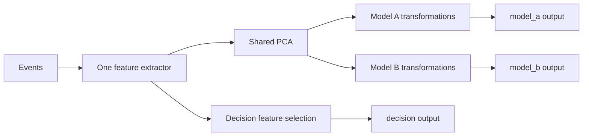

# Multiple pipeline outputs: graph architecture

Status: implemented contract with recorded decisions for
[#187](https://github.com/pbezglasny/fiml/issues/187).
This records the graph design discussed after the initial single-prefix draft.
The central builder and ownership rules, result access, offline batch results,
node-local PCA feature names, nonempty named outputs, indexed JSON format,
per-node internal buffers, a shared fitting mask, replay-based fitting without a
graph-wide training cache, and the absence of a backward-compatibility requirement
are agreed below. The runtime, authoring API, and version 4.0 serializer implement
this contract. Follow-up measurements may guide the deferred optimizations.

The [multiple-output API guide](multiple_output.md) now documents this graph
contract, replacing the reverted single-prefix exploration. Outputs can branch
from any preceding transformation node.

## Motivation

One event stream should produce feature vectors for several models and a
decision function. Two models may share fitted preprocessing such as PCA while
the decision function still needs the original price and other raw features.



Extraction and PCA each execute once per event during ordinary replay. The
decision chain reads the extractor's original vector. Applications remain
responsible for calling models and decision functions.

## Nodes and explicit sharing

Use one extractor root. Every transformation node consumes the vector of exactly
one parent and may have any number of consumers. Branching is allowed at any
depth. This is a rooted tree, a restricted acyclic graph; merging several parent
vectors is deferred.

A node represents an existing scalar or fitted vector stage. Its result may have
one or many coordinates. PCA remains one vector-valued node. Scalar stages keep
their grouped calculations and existing history sharing; individual arithmetic
operations do not need to become public nodes.

Reusing a node reference shares its computation, fitted parameters, and runtime
history. Creating two separate nodes creates independent state, even when their
configurations match. There is no automatic detection or merging of equivalent
nodes. Branches reference their parent directly rather than copying a prefix and
checking later that the copied prefix still matches.

## Central builder and configuration ownership

Decision: use a central `PipelineSpec` builder that owns the graph configuration.
The constructor creates the extractor root. `root()` returns its opaque `NodeId`;
`add(parent, stage)` appends a transformation and returns another `NodeId`.
`output(name, node)` registers an output, and `build()` creates an independent
pipeline from the current configuration.

Python training authoring:

```python
# Stage variables are supported
# transformation recipes, and PCA is the sklearn estimator.
spec = PipelineSpec(extractor_spec)
raw = spec.root()
projected = spec.add(raw, PCA(n_components=8))

model_a = spec.add(projected, model_a_transformation)
model_b = spec.add(projected, model_b_transformation)
decision = spec.add(raw, decision_selection)

spec.output("model_a", model_a)
spec.output("model_b", model_b)
spec.output("decision", decision)

pipeline = spec.build()
pipeline.fit(**training_events)
```

Rust uses the same construction pattern with fitted numeric stage parameters:

```rust,ignore
// Stage variables contain validated numeric definitions.
let mut spec = PipelineSpec::new(extractor_spec);
let raw = spec.root();
let projected = spec.add(raw, fitted_pca)?;
let model_a = spec.add(projected, model_a_stage)?;
let model_b = spec.add(projected, model_b_stage)?;
let decision = spec.add(raw, decision_stage)?;

spec.output("model_a", model_a)?;
spec.output("model_b", model_b)?;
spec.output("decision", decision)?;

let mut pipeline = spec.build()?;
```

The builder is append-only. Existing nodes cannot be edited, deleted, or
reparented; changing a transformation means creating a new node and the required
descendants. Registered output names cannot be rebound. New nodes and outputs
may be added after a build without changing previously built pipelines.

Every `NodeId` belongs to its originating builder. Reject references from another
builder rather than interpreting their numeric indexes locally. Handles do not
borrow the builder, so retaining a parent handle does not prevent further graph
construction in Rust. New nodes can reference only an existing parent. Builder
construction therefore cannot create cycles. Serialized configurations enforce
the same ordering by requiring every parent index to be less than its child index.

Snapshot caller-owned inputs when adding them: copy extractor and scalar
specifications and clone supported sklearn estimators as unfitted recipes using
the existing fitting helpers. Later changes to the caller's objects must not
change the builder. Rust owns the supplied numeric definitions. Reusing one
estimator object in two `add` calls creates two independent nodes; sharing is
expressed by reusing a `NodeId` as a parent.

`build()` takes a snapshot without consuming the builder. Each resulting pipeline
has independent fitted state, histories, and buffers. A built pipeline has fixed
topology; fitting replaces learned state transactionally and reset clears event
state. Neither operation changes the builder. A Python pipeline containing
unfitted recipes requires `fit()` before inference or fitted-artifact export.

## Named outputs and layouts

A runnable pipeline exposes one or more named `PipelineOutput` objects. Each
references a node; attaching a name does not add a calculation or copy. An output
can reference the extractor, an intermediate node, or a leaf.
Two names may expose the same node. An output with no additional transformations
is simply a reference to its input node.

Selection and reordering are explicit transformation stages. Arbitrary selected
columns generally need their own contiguous result buffer; they are not assumed
to be representable as a borrowed contiguous slice.

Output names should be unique, nonblank, and outside the `__reserved_` namespace.
Enumeration follows authored output order, independently of execution order.
Feature IDs are unique within a node's layout and may repeat in other nodes.
An input feature ID resolves against that node's parent layout.

Decision: fitted PCA components use local feature IDs `pc0`, `pc1`, and so on,
in zero-based component order. Do not prefix them with a stage name, node index,
or named output. Separate PCA nodes may reuse these IDs because downstream stages
resolve them only against their direct parent's layout. Named pipeline outputs
do not rename the features they expose.

A downstream stage may reference `pc0` before fitting. If the fitted parent does
not provide a referenced component, reject the candidate during fit validation
without replacing the previous working pipeline. Persist the fitted IDs and their
order in the stage's existing `outputs` field; loading preserves those IDs rather
than regenerating names from graph positions. This decision changes PCA naming;
other operations retain their existing feature-naming rules within each layout.

Node widths follow their stage definitions. Edges and named outputs expose only
active coordinates, excluding reserved storage in existing raw or model vectors.
New internal node buffers initially have their exact derived width.

Decision: every named output must contain at least one active feature. Reserved
capacity does not count toward that minimum. Reject a known zero-width output
during `build()` or artifact loading. When width depends on learned parameters,
reject it during `fit()` before installing the candidate runtime or artifact.
The error must identify the output; one empty output invalidates the operation
even if other outputs are nonempty. Do not silently omit it. Failed refits retain
the previous working runtime and artifact under the transactional fitting rule.

An output with no additional transformations remains valid when its referenced
node has active features. Warmup values consisting entirely of NaNs still have a
nonzero width. A batch with zero event rows is a separate case: zero rows do not
make an output zero-width. This decision constrains named outputs; internal stage
layouts remain subject to their operation-specific validation.

## Compilation and execution

Validate parent references, graph ownership of builder handles, cycles, stage
dimensions, feature IDs, and output names before creating a live inference
runtime. Validate structural references when authoring/building; checks depending
on learned widths or feature layouts run during fitting before installing its
candidate runtime. Compile references and feature IDs into indexes and produce a
fixed execution order in which every parent precedes its consumers. Reuse existing
stage operations and static dispatch; no new dependency is needed for this graph
shape.

For an accepted event, update the extractor once and refresh each transformation
node once in that order. Multiple downstream consumers never cause a shared node
to run again. Output reads only inspect completed results. Every configured
output is refreshed regardless of which outputs the caller later reads.

Each edge carries values, observation flags, and source clocks, with its feature
layout resolved during construction. Preserve existing semantics:

- Shared stateful nodes advance once according to their operation's rules;
  branch-local nodes own independent histories and warmup.
- Observation flags describe processing, not readiness or numeric changes.
- Context updates refresh stateless calculations without advancing market-event
  histories. Timed operations retain the existing source-clock behavior.
- Rejected events do not refresh transformed output buffers. Existing extractor
  and order-book error/resynchronization behavior still applies; this does not
  promise rollback of every extractor state transition.
- Batch replay retains the existing row-emission policy and aligned event rows
  across outputs, including warmup rows.

## Storage and borrowing

Decision: the runtime owns one preallocated result buffer per transformation node,
plus the extractor's existing storage and each operation's required metadata and
history. Consumers read their parent's buffer without modifying it. Parent results
remain available throughout the refresh, even after another branch has run.

Named outputs borrow node storage rather than owning duplicate final vectors.
Rust output access can return borrowed slices; callers must finish using those
borrows before mutating the runtime again. Python values remain independent NumPy
snapshots, and batch matrices/DataFrames allocate as they do today.

Allocate graph buffers and histories during construction. Graph evaluation and
Rust borrowed reads should allocate nothing during event processing. Existing
order-book storage allocations are a separate concern and must not be hidden by
that guarantee.

Result storage grows with the sum of node widths, plus metadata, fitted
parameters, and stateful histories. This retains more intermediate data than a
linear runtime that reuses scratch buffers. Begin with straightforward ownership;
measure before adding buffer-lifetime analysis or scratch-buffer reuse.
Caller-supplied storage for every graph node is deferred. The new interface does
not need a separate storage mode to preserve the old linear pipeline interface.

## Fitting and lifecycle

Decision: use one shared `fit_mask` for the entire graph. Per-output fitting masks
are deferred. Fit each shared estimator once per fit operation, then fit
downstream estimators against its fitted result. Separate nodes fit independently.
Sharing a PCA node therefore means sharing both its fitting-row selection and
learned parameters.

All event rows, including rows excluded from fitting, still replay to preserve
rolling and lag histories. Keep existing finite-value validation and supported
imputation behavior. Different branch warmup periods may require a mask that
excludes a longer initial interval; do not silently choose different fit rows for
each output.

Decision: use repeated event replay as needed during fitting, without a graph-wide
training-matrix cache. Fitting may require several replays to obtain inputs for
successive estimators. Within each replay, each participating shared node processes
an event once.
This does not promise one extraction pass for the complete fit operation. Reuse
the existing replay approach, accepting additional replay work in exchange for
avoiding a retained training matrix for every graph node. Temporary input matrices
needed to fit individual estimators remain part of fitting.

Fit transactionally: failure in any node preserves the previous fitted artifact
and live runtime. Successful fitting installs a cold runtime. Reset clears event
state across the graph while retaining fitted parameters and the existing symbol
handle contract. Export configuration and fitted numeric parameters, never live
histories, training rows, or Python estimator objects. Loading starts cold.

## Result access and offline replay

Decision: separate event processing from access to a named result. `Pipeline`
owns the graph, dispatches events, and manages fitting and reset.
`PipelineOutput` exposes a node's current values and layout. It does not execute
transformations or own another extractor/history. Python output objects remain
bound to their pipeline so subsequent reads see its updated result.

Current values are read through `pipeline.output(name).values()`, with layout
inspection such as `output.feature_names()` on the same object. There is no
pipeline-level `values()` or default-output selection. Unknown output names fail
explicitly in Python; Rust may use an `Option` lookup. A runnable graph with no
named outputs is rejected during construction.

Decision: Python `transform(...)` is an offline batch operation. It replays the
events once through the graph and returns `dict[str, numpy.ndarray]`, mapping
every output name to a matrix of shape `(n_events, output_width)`. Dictionary
order follows authored output order. This return type is the same with one or
many outputs; no `all_outputs` flag is needed. Output selection happens on the
returned dictionary. Shared nodes still run only once per event.

```python
# Online reads and offline replay use the same graph runtime.
model_a = pipeline.output("model_a")
decision = pipeline.output("decision")

# Online processing updates all nodes without building batch results.
pipeline.update(kind, symbol, timestamp, price=price, volume=volume)
latest_a = model_a.values()
latest_decision = decision.values()

# Offline replay collects every output for the following event batch.
batch = pipeline.transform(**following_events)
X_a = batch["model_a"]
X_b = batch["model_b"]
X_decision = batch["decision"]
```

After a nonempty replay, `output.values()` exposes the snapshot after the last
event, while the returned matrix contains all replay rows. Batch matrices belong
to the caller; `PipelineOutput` does not retain complete batch history.
`transform` advances the live runtime rather than resetting it implicitly.
`fit_transform` and order-book batch replay follow the same named-result rule;
DataFrame replay maps output names to DataFrames.

Online processing uses `update(...)` and output reads. It does not create a
dictionary or batch matrices for every event. Rust borrows node values without
allocation; Python `values()` continues to allocate an independent snapshot.
The Rust interface must distinguish a reusable output identifier from a short
borrow of its values so callers can retain the identifier across event updates.

Decision: output handles belong to the pipeline, not to an individual runtime
buffer or to the configuration builder. Python `PipelineOutput` objects and Rust
reusable output identifiers remain valid after `reset()` and successful refits.
They resolve the current runtime on access. A failed refit leaves their previous
runtime unchanged; a successful refit exposes the new cold runtime. Feature widths
and names may change after fitting, so output metadata must also come from the
current runtime. Previously returned Python snapshots remain independent.
Rust output identifiers from another pipeline are rejected, and value borrows
must end before updates, reset, or fitting can mutate the runtime. Builder
`NodeId` handles and runtime output identifiers are separate concepts.

## Artifact format and compatibility

Decision: backward compatibility is not a requirement. The new interface does
not preserve pipeline-level `values()`, single-matrix batch results, or a legacy
linear mode. Existing callers will need to use output objects and named batch
results.

Decision: graph artifacts use version `4.0` and a flat, ordered `nodes` array.
Each node's position is its artifact-local index. Node `0` contains the extractor;
every later node contains one existing fitted stage and its parent index. Named
outputs are stored in a separate ordered `outputs` array.

Version `3.0` reader/writer compatibility and an automatic migration are not
required. Existing specifications must be recreated and exported in the new
format. Old readers reject graph artifacts as unsupported. The nested extractor
keeps its independently versioned specification format.

The document has required fields `version`, `nodes`, and `outputs`, plus optional
opaque `checksum` metadata. Node and output records have these shapes:

- Extractor: `{"type": "extractor", "spec": <FeatureExtractorSpec>}`.
- Transformation: `{"type": "transform", "parent": <index>, "stage": <FittedStage>}`.
- Output: `{"name": <output name>, "node": <index>}`.

Stage payloads reuse the existing serialized scalar and fitted-vector
representations, including fitted numeric parameters. The graph does not store
separate node capacities or lengths; active layouts follow from extraction and
stage definitions. Nested extractor storage metadata retains its own format.

The following example defines a shared PCA, a model-A selection, a model-B scaler,
and a decision output exposing the extractor's original price and volume. Numeric
parameters are illustrative.

```json
{
  "version": "4.0",
  "nodes": [
    {
      "type": "extractor",
      "spec": {
        "version": "2.0",
        "capacity": 2,
        "length": 2,
        "required_events": [{"symbol": "btcusdt", "event": "trade"}],
        "features": [
          {
            "symbol": "btcusdt",
            "indicators": [
              {
                "kind": "field",
                "source": {"type": "field", "event": "trade", "field": "price"},
                "outputs": [{"id": "price"}]
              },
              {
                "kind": "field",
                "source": {"type": "field", "event": "trade", "field": "volume"},
                "outputs": [{"id": "volume"}]
              }
            ]
          }
        ]
      }
    },
    {
      "type": "transform",
      "parent": 0,
      "stage": {
        "type": "pca",
        "outputs": ["pc0", "pc1"],
        "mean": [100.0, 10.0],
        "components": [[0.8, 0.6], [-0.6, 0.8]],
        "output_scale": [1.0, 1.0]
      }
    },
    {
      "type": "transform",
      "parent": 1,
      "stage": {
        "type": "select",
        "outputs": ["pc0"],
        "input_indices": [0]
      }
    },
    {
      "type": "transform",
      "parent": 1,
      "stage": {
        "type": "standard_scale",
        "outputs": ["pc0", "pc1"],
        "mean": [0.0, 0.0],
        "scale": [2.0, 2.0]
      }
    }
  ],
  "outputs": [
    {"name": "model_a", "node": 2},
    {"name": "model_b", "node": 3},
    {"name": "decision", "node": 0}
  ]
}
```

Loading validates the complete artifact before exposing a runtime:

- Require exactly the supported pipeline version and reject unknown or missing
  fields consistently with the existing strict serializers.
- Require a nonempty node array with exactly one extractor at index `0`.
- For transformation node `i`, require an integer parent index satisfying
  `0 <= parent < i`. This rejects invalid references, forward references, self
  references, and cycles. Every parent chain necessarily reaches the extractor;
  no separate cycle traversal or topological sort is needed.
- Validate every stage's numeric parameters, dimensions, and feature IDs against
  its parent's active layout. Do not include reserved extractor cells as inputs.
- Require a nonempty output array, valid target indexes, unique valid names, and
  positive active output widths. Several output names may reference the same node.

The writer preserves node creation order and output registration order. The
reader preserves both array orders when loading and re-exporting. Output order
does not depend on node execution order. Do not use JSON object key order to encode
these contracts, or sort or deduplicate nodes during export.

Indexes are local to one artifact. Builder ownership tokens and runtime output
handles are never serialized; loading establishes fresh ownership. Editing array
positions manually requires updating the affected parent and output references.
There are no additional persistent node IDs or node names in this format.

Export configuration and fitted numeric state only. Do not export live values,
histories, clocks, buffers, training rows, or Python estimators. Loading starts
cold. The JSON Schema should describe record shapes and local numeric constraints;
reference bounds, parent ordering, and cross-node dimensions require runtime
validation. The schema and Rust serializer validate the same format.

## Deferred capabilities and implementation follow-up

Defer multiple-parent merges/concatenation, automatic deduplication, graph
mutation during live processing, independent fitting masks, and buffer reuse
optimization. Combining original features and PCA coordinates into one vector
would require a future merge operation; the separate decision output shown above
does not require it.

The implementation follows the agreed builder, ownership, result-access, PCA
feature-naming, nonempty-output, artifact-ordering, storage, and fitting rules.
Reconcile [#188](https://github.com/pbezglasny/fiml/issues/188),
[#189](https://github.com/pbezglasny/fiml/issues/189), and
[#190](https://github.com/pbezglasny/fiml/issues/190) with those decisions. Their
single-prefix assumptions and proposed method names must not constrain this
design.

Implementation validation should compare every output with an equivalent
independent pipeline, verify that shared histories advance only once per event
within each replay, and cover the common fitting mask, history updates for rows
excluded from fitting, and fitting each shared estimator once per fit operation.
Also cover context, source clocks, warmup, rejected events, book resynchronization,
transactional fitting, cold reload/reset, and artifact version validation. Cover
zero-width output rejection during construction, loading, and fitting, including
a failed refit with other nonempty outputs. Verify local PCA names, their reuse
across separate nodes, missing-component validation, and name/order preservation
through artifact round trips. Measure allocation behavior,
throughput, and intermediate storage against separate pipelines. The current graph tests and benchmark validate this implementation separately
from the historical single-prefix exploration.

## Implementation verification and measurements

The graph-specific tests cover shared history against independent pipelines,
alias buffer identity, builder/runtime ownership, stable output handles,
transactional refitting, changing learned widths, local PCA IDs, symbol-handle
normalization, ordered dictionaries, zero-row batches, and strict 4.0 artifacts.
Existing numeric, clock, context, and order-book fixtures now use the graph API.
Allocation tests include branching and retained output-ID reads during warmup
and steady event processing.

Local measurements on 2026-10-22, AMD Ryzen 9 9900X, Rust 1.98.1:

| Workload | Shared graph | Two independent pipelines |
| --- | ---: | ---: |
| 16 SMA coordinates, 8 PCA components, two lag branches | 117.98 ns/event | 213.33 ns/event |
| Retained runtime heap for a 128-sample SMA and two lag branches | 13,038 bytes | 24,586 bytes |

The timing benchmark uses release mode, ten samples, a one-second warmup, and a
one-second measurement period. These are small local workloads, not universal
latency guarantees. Heap measurements count live allocations after construction,
including compiled parameters, saved numeric configuration, metadata, and histories;
the source builder and allocator overhead are excluded. The timing and memory
rows use different workloads.

Reproduce with `cargo bench -p fiml --bench multiple_outputs -- --sample-size 10
--warm-up-time 1 --measurement-time 1` and
`cargo test -p fiml --all-features --test pipeline_allocations
shared_graph_retains_less_heap -- --nocapture`.

Validation passed: 346 Rust tests with all features on Rust 1.89.0, Python binding
compilation on Rust 1.89.0, 895 Python tests, workspace/all-target Clippy with
warnings denied, Rustdoc with warnings and missing docs denied, rustfmt, runnable
Python examples, and HTML execution of `notebooks/test.py`. Python tests emit
expected sklearn warnings for deliberately empty columns and degenerate PCA.
