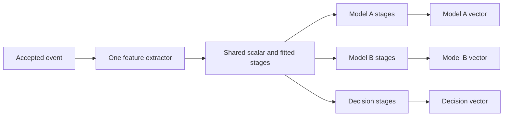

# Multiple pipeline outputs

Status: draft for discussion. This records the approach implemented during the
initial exploration and then reverted. The interfaces shown below are proposed;
they are not available in the restored source. Implementation should wait until
the design has been discussed.

## Requirement

One configuration should produce several feature vectors from the same event
stream: one for model A, another for model B, and another for a decision-making
function. Each output should support independent transformations while sharing
extraction and common stages.

The pipeline produces these vectors. The application remains responsible for
calling its models or decision function.

## Implemented approach: one shared prefix and named branches

The existing pipeline becomes the shared prefix. Each named output is a linear
chain consuming the final active vector from that prefix.



For example, the shared vector could contain price, moving averages, volatility,
and context values. Model A could select and standardize some columns, model B
could project other columns through PCA, and the decision branch could select
price and a threshold without scaling them.

Extraction and the shared stages execute once per accepted event. All branches
then consume the same snapshot. Common calculations must be placed explicitly
in the shared prefix; identical calculations written separately in branches are
not automatically combined.

This is a single branching point. Branches cannot read another branch, tap an
earlier stage, or merge again. A calculation needed only by two of three outputs
cannot have its own shared sub-branch in this design.

## Ownership and event processing

| State | Owner | Sharing |
| --- | --- | --- |
| Raw indicators, order books, context, timestamp validation | Existing feature extractor | One instance |
| Common transformations and their histories | Existing pipeline stages | Computed once |
| Branch scalers, PCA parameters, rolling and lag histories | Each output chain | Independent |
| Final values, feature IDs, observation masks | Each output | Separate stable storage |

The event path is:

1. Pass the event to the existing extractor and apply its validation rules.
2. Refresh the shared transformation chain.
3. Refresh every output chain using the shared values, observation flags, and
   source timestamps.
4. Let callers read the resulting vectors before applying another event.

Branch definitions are validated and compiled at construction. Feature IDs are
resolved to indexes then, rather than looked up on every event.

An empty branch copies the active shared layout. Named outputs have their own
width and IDs; they exclude the shared vector's reserved cells and have no
reserved capacity of their own. Output names must be unique, nonblank, and
outside the `__reserved_` namespace. Feature IDs may be reused across outputs.

Warm-up is independent for each branch. A ready decision vector does not make a
lagged model vector ready. Observation flags retain their existing meaning:
they describe processing, not readiness or numeric changes.

Context updates refresh stateless calculations without advancing market-event
histories. Source timestamps must propagate through the shared stages into each
branch so timed windows retain the existing per-symbol behavior. Rejected events
do not refresh output vectors; existing extractor behavior, including order-book
resynchronization after an error, remains in effect.

## Proposed Rust interface

The draft added two types:

- `PipelineOutputSpec`: a name and a sequence of existing `FittedStage` values.
- `PipelineOutput`: compiled branch state and its values, IDs, and observations.

The existing `PipelineSpec` gained `with_output(name, stages)` and `outputs()`.
Existing constructors continued to describe the shared prefix.

```rust,ignore
let spec = shared_spec
    .with_output("model_a", model_a_stages)?
    .with_output("model_b", model_b_stages)?
    .with_output("decision", decision_stages)?;

let mut pipeline = spec.build(raw_vector, shared_vector)?;
pipeline.handle_event(event)?;

let model_a = pipeline.output("model_a").unwrap().values();
let model_b = pipeline.output("model_b").unwrap().values();
let decision = pipeline.output("decision").unwrap().values();
```

`output(name)` returns `Option<&PipelineOutput>`. The output exposes `values()`,
`output_ids()`, `observations()`, and `name()`. `pipeline.outputs()` exposes outputs
in authored order, allowing callers to resolve a name once and retain its index.
Borrowing output slices allocates nothing.

Existing `pipeline.values()` and `pipeline.output_ids()` continue to describe
the shared vector. The raw and shared vectors remain caller-supplied through
the existing generic `build` interface. Branch vectors use internally allocated
`VecFeatureVector` storage; caller-supplied branch storage was not implemented.

## Proposed Python authoring

For already fitted parameters, `PipelineSpec.branch()` creates an independent
authoring copy of the shared prefix. It removes attached outputs and enables
automatic capacity, allowing a branch to be wider or narrower than the shared
vector. `shared.output(name, branch)` validates that the branch extends the same
prefix and stores only its additional stages.

```python
import fiml

raw = fiml.FeatureExtractorSpec().field(
    "BTCUSDT", source="trade_price", id="price"
)
shared = (
    fiml.PipelineSpec(raw)
    .identity("price")
    .sma("price", window=2, warmup=fiml.WarmupPolicy.FIRST_VALUE, output="average")
)

model_a = shared.branch().scale_stage([10., 10.], [2., 2.])
model_b = shared.branch().pca_stage(["pc"], [0., 0.], [[0.5, 0.5]], [1.])
decision = shared.branch().scalar_stage(fiml.ScalarStage().identity("price"))

shared.output("model_a", model_a)
shared.output("model_b", model_b)
shared.output("decision", decision)

pipeline = fiml.ModelInputPipeline.from_json(shared.to_json())
btc = pipeline.symbol("BTCUSDT")
pipeline.update(fiml.KIND_TRADE, btc, 0, price=12., volume=1.)

model_a_vector = pipeline.values("model_a")
model_b_vector = pipeline.values("model_b")
decision_vector = pipeline.values("decision")
```

The numbers above are illustrative fitted parameters. Shared stages must be
finished before outputs are attached; later shared mutations are rejected.
Mutating a branch authoring object after attachment does not change the parent.

The draft extended the existing runtime methods as follows:

| Call | Result |
| --- | --- |
| `values(name)` | Current NumPy snapshot for that output |
| `feature_names(name)` | That output's feature order |
| `n_features(name)`, `active_feature_count(name)` | That output's width |
| `output_names()` | Output names in authored order |
| `transform(..., all_outputs=True)` | Dict of named NumPy matrices from one replay |
| `transform_order_book(..., all_outputs=True)` | The same for order-book events |
| `compute_features(..., all_outputs=True)` | Dict of DataFrames with symbol/time metadata |

Omitting the name or `all_outputs` retains the existing shared-output behavior.
Requesting all outputs when none are configured raises an error. Event updates
always refresh all branches, regardless of which values the caller reads.

## Fitting independent transformations

The Python training recipe retained `add_transformation` for shared stages and
added `add_output(name, [(stage_name, transformer), ...])` for independent chains.
Each stage accepts an existing supported sklearn transformer or `ScalarStage`.

```python
from sklearn.decomposition import PCA
from sklearn.preprocessing import StandardScaler

# shared_spec contains extraction and any authored common transformations,
# with no named outputs attached yet.
pipeline = (
    fiml.ModelInputPipeline(shared_spec)
    .add_output("model_a", [("scale", StandardScaler())])
    .add_output("model_b", [("pca", PCA(n_components=1))])
    .add_output("decision", [("select", fiml.ScalarStage().identity("price"))])
)

outputs = pipeline.fit_transform(
    **events, fit_mask=training_rows, all_outputs=True
)
artifact = pipeline.to_json()
```

Shared estimators are fitted once. Each branch then fits independently with the
same training mask. All events, including excluded training rows, are replayed
to preserve rolling and lag histories. A branch can impute NaNs from shared
warm-up. The existing finite-value checks apply to the final branch training
rows. A failed fit leaves the previous artifact and live runtime unchanged;
successful fitting leaves the replacement runtime cold until replay begins.

The draft reused existing prefix replay during fitting. It therefore recomputes
extraction and completed stages across fitting passes. Sharing computation once
per event applies to online inference and ordinary batch replay, not the whole
training process. Caching or streaming shared training data was not implemented.

## Configuration format

The draft kept pipeline format version `3.0`, retained `feature_extractor` and
`model_input`, and added an optional top-level `outputs` array. `model_input`
describes the shared prefix. Each output contains a name and existing stage
representations; feature width is derived from its final stage.

For example, the following fragment attaches two outputs to a configuration
whose shared layout contains `price`:

```json
{
  "outputs": [
    {
      "name": "model_a",
      "stages": [
        {
          "type": "scalar",
          "transformations": [
            {"type": "standard_scale", "input": "price", "output": "scaled_price", "mean": 10.0, "scale": 2.0}
          ]
        }
      ]
    },
    {"name": "decision", "stages": []}
  ]
}
```

The full artifact stores extraction and shared stages once, plus all branch
parameters. Artifacts without outputs keep their existing serialization. Older
runtimes reject the new field because deserialization denies unknown fields.
Whether this warrants a format-version bump remains a design decision.

## Memory and implementation tradeoffs

The draft reused the existing `StageRuntime` for branch chains and extended it
to propagate final source clocks. It did not introduce a general graph executor
or new dependencies.

Runtime buffers, compiled stages, and histories are allocated at construction.
Rust event processing performs no heap allocation. This does not mean no copying:
each nonempty branch copies the shared active values and observation flags into
its existing stage input buffer. Empty branches also copy their output values.
Shared indicator computation and history are reused, but final branch buffers
are distinct. Python snapshots and batch matrices allocate as before.

Memory grows with each branch's output width, intermediate scratch widths, and
stateful transformer histories. Placing a common rolling calculation in the
shared prefix avoids duplicating its history. Identical rolling calculations
authored separately in two branches retain two histories.

A significant limitation is preserving raw data around destructive shared
transformations. If the shared prefix ends in PCA, a decision branch cannot
retrieve the original price unless that value survives the shared layout.
Supporting raw or intermediate taps would require a different interface.

## Work involved and validation of the reverted draft

Implementation touched Rust pipeline configuration/runtime, stage clock
propagation, public exports and errors, JSON serialization/schema, Python
builders, training, event replay and DataFrame output, plus examples and tests.

Before reverting, checks passed for the full Rust suite, 649 Python tests,
Clippy, strict Rust documentation, the notebook check, and a runnable example.
Specific regressions compared branches with independent pipelines, including
context updates, timed windows, reserved capacity, rejected events, order-book
error prefixes, JSON round-tripping, fitting failures, and zero allocations in
Rust event updates. No throughput or memory-size benchmark was run. These are
historical results for the reverted draft, not tests retained with this document.

## Questions to resolve before implementation

1. Is one shared prefix enough, or should outputs tap raw data or intermediate
   stages? Do some outputs need to share a calculation that others bypass?
2. Should named outputs be the default result when configured, or should callers
   explicitly request them with `all_outputs=True`?
3. Is internally allocated branch storage acceptable in Rust, or must callers
   supply branch buffers too?
4. Are separate final buffers and copying shared values acceptable, or are
   borrowed views required for outputs that only select columns?
5. Is sharing during inference sufficient, or must training also avoid repeating
   extraction? Does each output need its own training mask?
6. Should the new configuration require a format-version bump?
