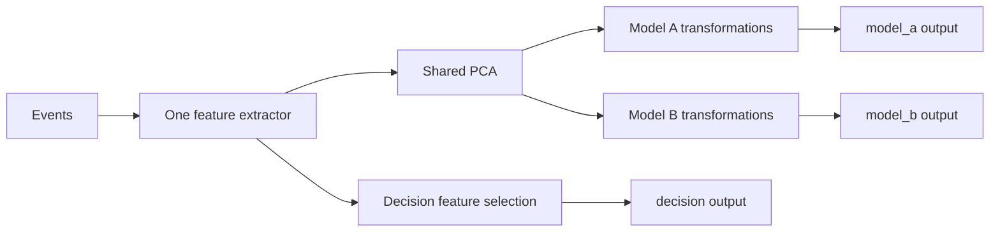

[English](../multiple_output-arc.md)

<a id="multiple-pipeline-outputs-graph-architecture"></a>

# Несколько выходов конвейера: архитектура графа

Статус: реализованный контракт с решениями для
[#187](https://github.com/pbezglasny/fiml/issues/187).
Зафиксирован проект графа после первоначального варианта с одним префиксом.
Согласованы центральный построитель и владение, чтение результатов, пакетные
результаты, локальные имена PCA, непустые выходы, индексированный JSON, буферы
узлов, общая маска, обучение повторным воспроизведением без общего кэша и отсутствие
требования обратной совместимости. Исполнение, API и сериализатор 4.0 реализуют
контракт; дальнейшие замеры могут обосновать отложенные оптимизации.

[Руководство нескольких выходов](multiple_output.md) описывает этот граф вместо
отменённого исследования одного префикса. Выходы могут ветвиться от любого
предыдущего узла преобразования.

<a id="motivation"></a>

## Мотивация

Один поток должен давать векторы нескольким моделям и функции решения. Модели
могут разделять обученный PCA, а решению нужны исходная цена и другие признаки.



При обычном воспроизведении извлечение и PCA выполняются раз на событие.
Цепочка решения читает исходный вектор. Модели и решения вызывает приложение.

<a id="nodes-and-explicit-sharing"></a>

## Узлы и явное совместное использование

Один корень-экстрактор. Каждый узел читает ровно одного родителя и имеет любое
число потребителей. Ветвление на любой глубине. Это корневое дерево, ограниченный
ациклический граф; слияния родителей отложены.

Узел — существующий скалярный/обученный векторный этап с одной или несколькими
координатами. PCA остаётся одним векторным узлом. Скалярные этапы сохраняют группы
и общую историю; отдельные арифметические операции не становятся публичными узлами.

Повтор ссылки на узел разделяет вычисления, параметры и историю. Два отдельных
узла независимы даже при одинаковой конфигурации. Автоматического обнаружения/
слияния эквивалентов нет. Ветви прямо ссылаются на родителя без копирования префикса
и последующей проверки совпадения копий.

<a id="central-builder-and-configuration-ownership"></a>

## Центральный построитель и владение конфигурацией

Решение: `PipelineSpec` владеет графом. Конструктор создаёт корень, `root()`
возвращает непрозрачный `NodeId`; `add(parent, stage)` добавляет преобразование и
возвращает новый `NodeId`. `output(name, node)` регистрирует выход, `build()`
создаёт независимый конвейер по текущей конфигурации.

Обучение Python:

```python
# Stage variables are supported
# transformation recipes, and PCA is the sklearn estimator.
spec = PipelineSpec(extractor_spec)
raw = spec.root()
projected = spec.add(raw, PCA(n_components=8))

model_a = spec.add(projected, model_a_transformation)
model_b = spec.add(projected, model_b_transformation)
decision = spec.add(raw, decision_selection)

spec.output("model_a", model_a)
spec.output("model_b", model_b)
spec.output("decision", decision)

pipeline = spec.build()
pipeline.fit(**training_events)
```

Rust использует ту же форму с обученными числовыми параметрами:

```rust,ignore
// Stage variables contain validated numeric definitions.
let mut spec = PipelineSpec::new(extractor_spec);
let raw = spec.root();
let projected = spec.add(raw, fitted_pca)?;
let model_a = spec.add(projected, model_a_stage)?;
let model_b = spec.add(projected, model_b_stage)?;
let decision = spec.add(raw, decision_stage)?;

spec.output("model_a", model_a)?;
spec.output("model_b", model_b)?;
spec.output("decision", decision)?;

let mut pipeline = spec.build()?;
```

Построитель допускает только добавление. Узлы нельзя менять, удалять, переподчинять;
для изменения создайте новый узел и потомков. Имена выходов нельзя переназначать.
Новые узлы/выходы после build не меняют уже созданные конвейеры.

`NodeId` принадлежит исходному построителю. Чужие ссылки отклоняются, а не
интерпретируются локальными индексами. Дескрипторы не заимствуют построитель:
сохранение родителя не мешает продолжать Rust-построение. Родитель уже существует,
поэтому цикл невозможен. JSON требует индекс родителя меньше индекса потомка.

При добавлении снимайте копию экстрактора/скалярной спецификации, клонируйте
поддерживаемые sklearn как необученные описания существующими помощниками.
Последующие изменения пользователя не влияют на построитель. Rust владеет
числовыми определениями. Один оцениватель в двух `add` создаёт независимые узлы;
совместное использование выражается общим родителем `NodeId`.

`build()` снимает копию, не потребляя построитель. Каждый конвейер имеет независимые
параметры, историю, буферы и фиксированную топологию. Fit транзакционно заменяет
обученное состояние, reset очищает события; построитель не меняется.
Python с необученными описаниями требует `fit()` до применения/экспорта.

<a id="named-outputs-and-layouts"></a>

## Именованные выходы и раскладки

Исполняемый конвейер открывает один или несколько `PipelineOutput`. Имя ссылается
на узел без нового расчёта/копии. Это может быть корень, промежуточный узел или лист.
Два имени могут открывать один узел. Выход без дополнительных операций — ссылка
на входной узел.

Отбор/перестановка — явные этапы. Произвольным столбцам обычно нужен свой
непрерывный буфер; нельзя считать их заимствуемым непрерывным срезом.

Имена уникальны, непусты, вне `__reserved_`. Перечисление следует авторскому порядку,
не исполнению. ID уникальны внутри узла и могут повторяться в других. Входной ID
разрешается в раскладке родителя.

Решение: компоненты PCA — локальные `pc0`, `pc1` и т. д. по порядку от нуля, без
префикса этапа/узла/выхода. Разные PCA могут повторять ID: потомок видит только
прямого родителя. Именованный выход не переименовывает признаки.

Потомок может ссылаться на `pc0` до fit. Если обученный родитель не даёт компоненту,
отклонить кандидат при проверке fit, сохранив рабочий конвейер. ID/порядок хранятся
в существующем `outputs`; загрузка сохраняет их, не выводит из позиций графа.
Меняется именование PCA, другие операции сохраняют правила внутри раскладки.

Ширина определяется этапом. Рёбра/выходы открывают только активные координаты,
без резервов исходных/модельных векторов. Новые буферы имеют точную производную ширину.

Решение: каждый выход содержит минимум один активный признак. Резерв не считается.
Известную нулевую ширину отклонять при build/загрузке; обучаемую — при fit до
установки кандидата. Ошибка называет выход. Один пустой выход делает всю операцию
ошибочной даже при других непустых; нельзя молча опускать. Неудачный refit сохраняет
рабочий экземпляр/артефакт.

Без дополнительных преобразований выход допустим при активных признаках узла.
Все NaN прогрева всё ещё имеют ненулевую ширину. Нулевое число строк пакета —
отдельный случай, не нулевая ширина. Ограничение относится к именованным выходам;
внутренние раскладки проверяются правилами своих операций.

<a id="compilation-and-execution"></a>

## Компиляция и исполнение

До живого исполнения проверить родителей, владение дескрипторами, циклы,
размерности, ID и имена. Структурные ссылки — при создании/build; обученные ширины/
раскладки — при fit до установки кандидата. Скомпилировать ссылки/ID в индексы и
фиксированный порядок «родитель раньше потребителя». Использовать существующие
операции и статическую диспетчеризацию; новая зависимость не нужна.

На принятое событие один раз обновить экстрактор и каждый узел в этом порядке.
Несколько потребителей не запускают общий узел повторно. Чтение только смотрит
готовый результат. Обновляются все выходы независимо от последующего чтения.

Ребро несёт значения, флаги наблюдений, часы источников; раскладка разрешена при
создании. Сохранить семантику:

- Общий узел с состоянием продвигается раз по своим правилам; локальные ветви
  имеют независимые истории/прогрев.
- Флаги описывают обработку, не готовность/изменение числа.
- Контекст обновляет расчёты без состояния без продвижения рыночной истории.
  Временные операции сохраняют часы источников.
- Отклонённые события не обновляют преобразованные буферы. Правила ошибок/
  синхронизации экстрактора/стакана прежние; полного отката всех переходов не обещается.
- Пакеты сохраняют политику выдачи строк и выравнивание выходов, включая прогрев.

<a id="storage-and-borrowing"></a>

## Хранилище и заимствование

Решение: среда владеет готовым буфером результата на узел плюс хранилищем
экстрактора, метаданными и историей операций. Потомки читают родителя без изменения.
Результат родителя доступен весь пересчёт, даже после другой ветви.

Выходы заимствуют хранилище узла без дублированных итоговых векторов.
Rust возвращает срезы; заимствования заканчиваются до изменения среды.
Python возвращает независимые NumPy-снимки; пакеты/DataFrame выделяются как прежде.

Буферы/история выделяются при создании. Граф и заимствованное чтение Rust не должны
выделять память на событиях. Выделения стакана — отдельная область, не скрываемая
этой гарантией.

Память растёт с суммой ширин, метаданными, обученными параметрами и историей.
Промежуточных данных больше, чем у линейного конвейера с временным буфером.
Начать с простого владения; до анализа сроков жизни/переиспользования буферов —
измерения. Пользовательское хранилище каждого узла отложено. Отдельный режим ради
старого линейного интерфейса не нужен.

<a id="fitting-and-lifecycle"></a>

## Обучение и жизненный цикл

Решение: одна общая `fit_mask` графа; отдельные маски выходов отложены. Общий
оцениватель обучается раз за fit, потомки — на его результате. Отдельные узлы
независимы. Общий PCA означает общие строки обучения и параметры.

Все события, включая исключённые, воспроизводятся ради окон/лагов. Сохранить
проверку конечности и заполнение пропусков. Разный прогрев ветвей может требовать
более длинного исключённого начала; нельзя молча выбирать разные строки по выходам.

Решение: повторять воспроизведение по необходимости без общего кэша обучающих
матриц графа. Для последовательных оценивателей может понадобиться несколько
проходов; внутри прохода участвующий общий узел обрабатывает событие раз.
Одного прохода извлечения за весь fit не обещается. Повторная работа предпочтена
хранению матрицы каждого узла. Временные входные матрицы отдельных оценивателей остаются.

Fit транзакционен: ошибка узла сохраняет старый артефакт/живую среду. Успех
устанавливает холодную среду. Reset очищает события всего графа, сохраняя параметры
и контракт дескрипторов символов. Экспортировать конфигурацию/числовые параметры,
не историю, обучающие строки и объекты Python. Загрузка холодная.

<a id="result-access-and-offline-replay"></a>

## Чтение результатов и офлайн-воспроизведение

Решение: отделить обработку от именованного результата. `Pipeline` владеет графом,
событиями, fit/reset. `PipelineOutput` открывает значения/раскладку, не вычисляет
и не владеет другим экстрактором/историей. Python-объект привязан к конвейеру и
видит обновлённые результаты.

Чтение — `pipeline.output(name).values()`, метаданные — например
`output.feature_names()`. Нет `values()` конвейера и выхода по умолчанию.
Неизвестные имена явно ошибочны в Python, Rust может вернуть `Option`.
Граф без выходов отклоняется при создании.

Решение: Python `transform(...)` — пакетная операция: один проход графа и
`dict[str, numpy.ndarray]` всех имён с матрицами `(n_events, output_width)`.
Порядок словаря авторский, тип одинаков для одного/нескольких выходов, флага
`all_outputs` нет. Выбор — в возвращённом словаре. Общие узлы работают раз на событие.

```python
# Online reads and offline replay use the same graph runtime.
model_a = pipeline.output("model_a")
decision = pipeline.output("decision")

# Online processing updates all nodes without building batch results.
pipeline.update(kind, symbol, timestamp, price=price, volume=volume)
latest_a = model_a.values()
latest_decision = decision.values()

# Offline replay collects every output for the following event batch.
batch = pipeline.transform(**following_events)
X_a = batch["model_a"]
X_b = batch["model_b"]
X_decision = batch["decision"]
```

После непустого прохода `output.values()` — последний снимок, матрица — все строки.
Матрицы принадлежат вызывающему коду; `PipelineOutput` не хранит пакетную историю.
`transform` продвигает живую среду без неявного сброса. `fit_transform` и пакеты
стакана следуют правилу имён; DataFrame-воспроизведение возвращает словарь таблиц.

Онлайн — `update(...)` и чтение, без словарей/матриц на событие. Rust заимствует
без выделений; Python `values()` выделяет независимый снимок. Rust различает
повторно используемый ID и короткое заимствование, чтобы ID переживал обновления.

Решение: дескрипторы принадлежат конвейеру, не буферу и не построителю.
Python `PipelineOutput` и Rust ID сохраняются после reset/успешного refit и
разрешаются в текущей среде. Неудача сохраняет старую, успех открывает новую холодную.
Имена/ширины после обучения могут меняться; метаданные тоже читаются из текущей
среды. Старые Python-снимки независимы. Rust отклоняет чужие ID, заимствования
должны закончиться до update/reset/fit. `NodeId` построителя и ID выхода — разные понятия.

<a id="artifact-format-and-compatibility"></a>

## Формат артефакта и совместимость

Решение: обратная совместимость не требуется. Не сохраняются `values()` конвейера,
одна матрица пакета и старый линейный режим. Вызывающему коду нужны объекты выходов
и именованные пакетные результаты.

Решение: версия `4.0`, плоский упорядоченный `nodes`. Позиция — локальный индекс.
Узел `0` содержит экстрактор; следующие — существующий обученный этап и индекс
родителя. Выходы хранятся отдельным упорядоченным `outputs`.

Совместимость чтения/записи `3.0` и автомиграция не требуются. Старые спецификации
пересоздаются и экспортируются. Старые читатели отклоняют граф. Вложенный
экстрактор сохраняет независимую версию.

Обязательны `version`, `nodes`, `outputs`; `checksum` — необязательные непрозрачные
метаданные. Формы записей:

- Экстрактор: `{"type": "extractor", "spec": <FeatureExtractorSpec>}`.
- Преобразование: `{"type": "transform", "parent": <index>, "stage": <FittedStage>}`.
- Выход: `{"name": <output name>, "node": <index>}`.

Этапы используют прежние скалярные/векторные представления с обученными параметрами.
Отдельных ёмкостей/длин узлов нет: активная раскладка выводится из определений.
Метаданные хранения экстрактора сохраняют свой формат.

Пример: общий PCA, отбор модели A, масштабирование B и решение по исходным цене/
объёму. Числовые параметры иллюстративны.

```json
{
  "version": "4.0",
  "nodes": [
    {
      "type": "extractor",
      "spec": {
        "version": "2.0",
        "capacity": 2,
        "length": 2,
        "required_events": [{"symbol": "btcusdt", "event": "trade"}],
        "features": [
          {
            "symbol": "btcusdt",
            "indicators": [
              {
                "kind": "field",
                "source": {"type": "field", "event": "trade", "field": "price"},
                "outputs": [{"id": "price"}]
              },
              {
                "kind": "field",
                "source": {"type": "field", "event": "trade", "field": "volume"},
                "outputs": [{"id": "volume"}]
              }
            ]
          }
        ]
      }
    },
    {
      "type": "transform",
      "parent": 0,
      "stage": {
        "type": "pca",
        "outputs": ["pc0", "pc1"],
        "mean": [100.0, 10.0],
        "components": [[0.8, 0.6], [-0.6, 0.8]],
        "output_scale": [1.0, 1.0]
      }
    },
    {
      "type": "transform",
      "parent": 1,
      "stage": {
        "type": "select",
        "outputs": ["pc0"],
        "input_indices": [0]
      }
    },
    {
      "type": "transform",
      "parent": 1,
      "stage": {
        "type": "standard_scale",
        "outputs": ["pc0", "pc1"],
        "mean": [0.0, 0.0],
        "scale": [2.0, 2.0]
      }
    }
  ],
  "outputs": [
    {"name": "model_a", "node": 2},
    {"name": "model_b", "node": 3},
    {"name": "decision", "node": 0}
  ]
}
```

До выдачи среды загрузка проверяет всё:

- Точную версию, неизвестные/недостающие поля по строгим правилам.
- Непустые узлы, ровно один экстрактор в `0`.
- У преобразования `i` целый родитель `0 <= parent < i`. Это исключает неверные,
  будущие, собственные ссылки и циклы. Цепочка достигает корня; отдельный обход
  циклов/топологическая сортировка не нужны.
- Числа, размерности, ID каждого этапа относительно активного родителя; резерв
  экстрактора не используется.
- Непустые выходы, допустимые индексы, уникальные корректные имена, положительные
  активные ширины. Несколько имён могут ссылаться на узел.

Запись сохраняет создание узлов и регистрацию выходов, чтение/повторный экспорт —
оба порядка. Выходы не зависят от исполнения. Не кодировать порядок ключами объекта
JSON, не сортировать/дедуплицировать узлы при экспорте.

Индексы локальны артефакту. Токены владения и дескрипторы не сериализуются;
загрузка создаёт новое владение. Ручная перестановка массива требует обновить
родительские/выходные ссылки. Дополнительных постоянных ID/имён узлов нет.

Экспортировать только конфигурацию и обученное числовое состояние, не значения,
историю, часы, буферы, строки обучения, оцениватели. Загрузка холодная. Schema
описывает формы/локальные числовые ограничения; границы ссылок, порядок родителей,
межузловые размерности проверяет runtime. Схема и сериализатор проверяют один формат.

<a id="deferred-capabilities-and-implementation-follow-up"></a>

## Отложенные возможности и продолжение реализации

Отложены слияния/конкатенации родителей, дедупликация, живое изменение графа,
разные маски, переиспользование буферов. Объединению исходных признаков с PCA в
один вектор нужна будущая операция слияния; отдельному выходу решения она не нужна.

Реализация следует согласованным правилам построителя, владения, результатов,
имён PCA, непустоты, порядка артефакта, хранения, обучения. Согласовать
[#188](https://github.com/pbezglasny/fiml/issues/188),
[#189](https://github.com/pbezglasny/fiml/issues/189),
[#190](https://github.com/pbezglasny/fiml/issues/190) с ними. Предположения одного
префикса и предложенные имена методов не должны ограничивать проект.

Проверить каждый выход против независимого конвейера, однократное продвижение
общей истории на событие/проход, общую маску, историю исключённых строк и однократное
обучение общего оценивателя. Покрыть контекст, часы, прогрев, отклонения,
синхронизацию, транзакционный fit, холодную загрузку/reset и версию.
Проверить нулевые ширины на создании/загрузке/fit, включая неудачный refit с другими
непустыми выходами. Проверить локальные/повторные имена PCA, отсутствующие компоненты,
порядок/имена после JSON. Измерить выделения, скорость и промежуточную память
относительно отдельных конвейеров. Текущие тесты/замер графа проверяют эту реализацию
отдельно от исторического исследования одного префикса.

<a id="implementation-verification-and-measurements"></a>

## Проверка реализации и измерения

Тесты графа покрывают общую историю против независимых конвейеров, тождество буфера
псевдонима, владение, стабильные выходные дескрипторы, транзакционный refit, меняемые
ширины, локальные PCA ID, нормализацию символов, порядок словарей, пустые пакеты,
строгие артефакты 4.0. Числовые, временные, контекстные и стаканные фикстуры используют
граф. Тесты памяти включают ветвление и чтение сохранённого ID при прогреве/работе.

Локальные замеры 2026-10-22, AMD Ryzen 9 9900X, Rust 1.98.1:

| Нагрузка | Общий граф | Два независимых конвейера |
| --- | ---: | ---: |
| 16 координат SMA, 8 PCA-компонент, две ветви лагов | 117.98 нс/событие | 213.33 нс/событие |
| Живая куча для SMA на 128 отсчётов и двух ветвей лагов | 13 038 байт | 24 586 байт |

Временной замер: release, 10 выборок, прогрев 1 с, измерение 1 с. Это небольшие
локальные нагрузки, не универсальные гарантии. Память считает живые выделения
после создания: параметры, сохранённую конфигурацию, метаданные, историю;
построитель и накладные расходы аллокатора исключены. Строки времени и памяти
используют разные нагрузки.

Повторить: `cargo bench -p fiml --bench multiple_outputs -- --sample-size 10
--warm-up-time 1 --measurement-time 1` и
`cargo test -p fiml --all-features --test pipeline_allocations
shared_graph_retains_less_heap -- --nocapture`.

Прошли: 346 Rust-тестов со всеми возможностями на 1.89.0, компиляция Python-привязок
на 1.89.0, 895 Python-тестов, workspace/all-target Clippy без предупреждений,
Rustdoc без предупреждений/недостающих docs, rustfmt, запускаемые Python-примеры,
HTML-исполнение `notebooks/test.py`. Python выдаёт ожидаемые предупреждения sklearn
для намеренно пустых столбцов и вырожденного PCA.
