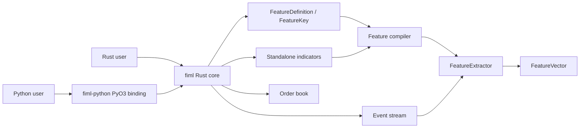
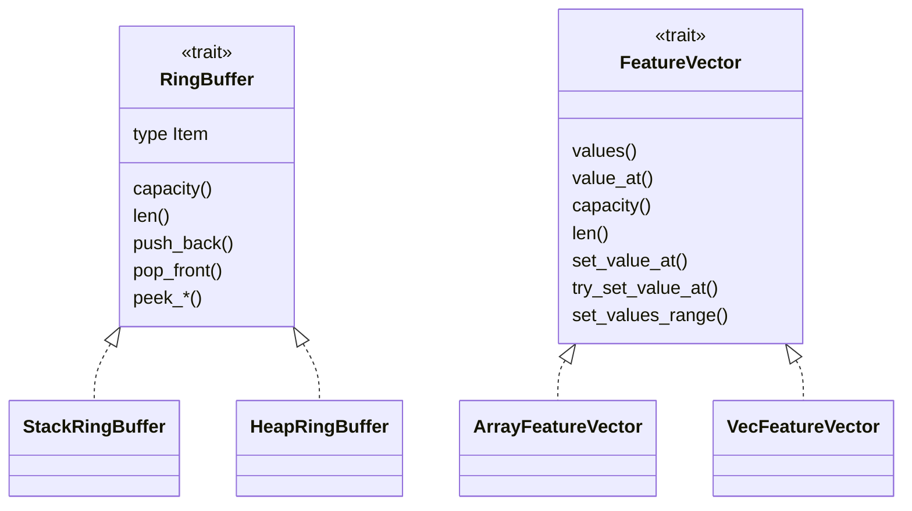

[English](../project-schema.md)

<a id="project-type-and-dependency-schema"></a>

# Схема типов и зависимостей проекта

Документ описывает действующие производственные типы workspace `fiml`.
Тестовые помощники и исторические проекты исключены.

Обозначения зависимостей:

- `A --> B`: `A` вызывает, создаёт, преобразуется в `B` или ограничен им.
- `A *-- B`: `A` владеет `B`.
- `A o-- B`: `A` содержит/заимствует `B` через generic или вариант enum.
- `Trait <|.. Type`: `Type` реализует `Trait`.

<a id="workspace-boundary"></a>

## Граница workspace



Экстрактор и стакан используют общие числовые типы и ошибки. Состояние стакана
пока не представлено вычислением признака.

<a id="cargo-features-and-targets"></a>

### Возможности и цели Cargo

| Элемент | Текущее состояние |
|---|---|
| Возможности ядра по умолчанию | Пусто. |
| `serde` | Включает Serde для `Symbol`, `WarmupPolicy`, `EventKind`; у определений нет модуля сериализации. |
| `tracing` | Необязательная диагностика отдельных индикаторов. |
| Примеры | Автопоиск выключен; явные цели: `feature_extractor`, `binance_trades`, `historical_trade_replay`, `feature_extractor_spec_from_json`. |
| Бенчмарки | Автопоиск выключен; явные цели `sma`, `ring_buffer`. |
| Зависимость Python | `fiml-python` использует ядро без необязательных возможностей. |

<a id="foundational-abstractions"></a>

## Базовые абстракции



| Тип | Роль |
|---|---|
| `RingBuffer` | Контракт ограниченной истории для стековых и кучевых буферов. |
| `FeatureVector` | Изменяемое хранилище `f64`. `ArrayFeatureVector<N>` не выделяет память; размер `VecFeatureVector` выбирается при исполнении. |
| `WarmupPolicy` | Общая политика готовности оконных расчётов. |
| `FimlError` | Общая публичная ошибка; `Result<T>` — псевдоним `Result<T, FimlError>`. |

<a id="feature-definition-and-compilation"></a>

## Определение и компиляция признаков

`FeatureDefinition` описывает ровно одну скалярную ячейку. Совместимые определения
могут разделять одно рабочее вычисление.

```mermaid
flowchart LR
    Definition["FeatureDefinition"] *-- Key["FeatureKey"]
    Definition *-- Id["FeatureId"]
    Key o-- Symbol
    Key o--|calendar routing| Source["FeatureSource"]
    Key o--|scalar inputs| Field["EventField"]
    Key o-- WarmupPolicy
    Source --> Field["EventField"]
    Source --> Kind["EventKind"]

    Builder["FeatureExtractorBuilder"] *--|Vec| Definition
    Builder *-- Output["V: FeatureVector"]
    Builder --> Compiler["compiler::compile"]
    Compiler --> Groups["FeatureGroup"]
    Groups --> Compilation["Compilation"]
    Compilation *-- Derivations["Box<[FeatureDerivation]> "]
    Compilation *-- Ranges["Box<[OutputRange]>"]
    Compilation *-- Ids["Box<[FeatureId]>"]
    Compilation *-- Router["EventRouter"]
```

| Тип | Видимость | Значение |
|---|---|---|
| `FeatureDefinition` | Публичный | Структурный `FeatureKey` со стабильным пользовательским `FeatureId`. |
| `FeatureKey` | Публичный закрытый enum | Полная идентичность скалярного расчёта. Ключи сделок имеют неявный источник; скалярные индикаторы принимают `EventField`, календарные — `FeatureSource`. |
| `FeatureId` | Публичный | Имя схемы/поиска: явное или детерминированное по ключу. |
| `FeatureSource` | Публичный | `Field(EventField)`, `Event(EventKind)`, `AnyEvent`. |
| `EventField` | Публичный | Извлекаемые поля: цена, объём, цена и объём сделки. |
| `FeatureExtractorBuilder<V>` | Публичный | Собирает определения и владеет выбранным вектором до `build`. |
| `FeatureGroup` / `GroupKey` | Внутренний | Группировка определений с общей историей вне горячего пути. |
| `OutputRange` | Внутренний | Начало/число соседних ячеек одного вычисления. |
| `Compilation` | Внутренний | Проверенные вычисления, диапазоны, ID и маршруты для экстрактора. |

Компилятор отклоняет повторные ключи/ID, проверяет окна, группирует совместимые
определения, назначает непрерывные диапазоны и создаёт маршрутизатор. Типы источников
исключают неподдерживаемые конфигурации Rust; JSON проверяет поля источника до ключей.
Временные карты удаляются до обработки событий.

<a id="key-to-runtime-mapping"></a>

### Соответствие ключей рабочим расчётам

| Вариант `FeatureKey` | Рабочее вычисление | Состояние | Маршрут |
|---|---|---|---|
| `Field` | `Field(EventField)` | Последний скаляр в выходном хранилище | Вид `EventField` и настроенный символ. |
| `Cvd` | `CvdFeature` | `CumulativeVolumeDelta<HeapRingBuffer<f64>, 16>` | Сделки настроенного символа. |
| `SmaTimed` | `SmaTimedFeature` | `SimpleMovingAverageTimed<HeapRingBuffer<(i64, f64)>, 16>` | Все события символа, включая виды без подходящих отсчётов. |
| `ObvTimed` | `ObvTimedFeature` | `OnBalanceVolumeTimed<HeapRingBuffer<ObvBucket>, 16>` | Все события символа. |
| `TradeCountTimed` | `TradeCountTimedFeature` | `TradeCountTimed<HeapRingBuffer<CountBucket>>` | Все события символа. |
| `TradeVolumeTimed` | `TradeVolumeTimedFeature` | `RollingTradeVolumeTimed<HeapRingBuffer<TradeVolumeBucket>, 16>` | Все события символа. |
| `VwapTimed` | `VwapTimedFeature` | `VolumeWeightedAveragePriceTimed<HeapRingBuffer<VwapBucket>, 16>` | Все события символа. |
| `DayOfWeek` | `DayOfWeek` | Состояние часов в вычислении | Глобальный AnyEvent не раньше максимума; явные символ/вид сохраняют область. |
| `TimeSinceFirstEventOfDay` | `TimeSinceFirstEventOfDay` | Состояние часов в вычислении | Глобальный AnyEvent не раньше максимума; явные символ/вид сохраняют область. |

`MAX_OUTPUTS_PER_INDICATOR` сейчас 16: предел соседних скалярных выходов одного вычисления.

<a id="events-and-routing"></a>

## События и маршрутизация

```mermaid
flowchart LR
    Event["Event"] --> Kind["EventKind"]
    Event --> Symbol
    Event --> Timestamp

    Router["EventRouter"] *-- SymbolMap["symbol_to_index"]
    Router *-- SymbolRouters["symbol_routers"]
    Router *-- Subscribers["subscribers"]
    Router *-- Any["any_subscribers"]
    SymbolMap --> SymbolRouters
    SymbolRouters --> Subscribers
    Kind --> SymbolRouters
    Any --> Subscribers
    Subscribers --> RuntimeIndex["FeatureDerivation index"]
```

`EventKind` имеет шесть вариантов: цена, объём, сделка, дельта стакана, снимок,
время. Дискриминанты индексируют фиксированные массивы маршрутов. Маршрут символ/
вид — непрерывный диапазон плоского массива подписчиков; значение — индекс
вычисления. Отдельный диапазон постоянных подписчиков содержит временные расчёты
и часы.

`Symbol` — компактный интернированный дескриптор без учёта регистра ASCII.
`Symbol::GLOBAL` — резервный индекс `0`, имя `"__global__"`, для времени и глобальных ключей.

<a id="extractor-runtime"></a>

## Среда исполнения экстрактора

```mermaid
flowchart LR
    Builder["FeatureExtractor::builder(output)"] --> Compile["build / compile"]
    Compile --> Extractor["FeatureExtractor<V>"]
    Extractor *-- Vector["V: FeatureVector"]
    Extractor *-- Features["Box<[FeatureDerivation]> "]
    Extractor *-- Ranges["Box<[OutputRange]>"]
    Extractor *-- Ids["Box<[FeatureId]>"]
    Extractor *-- Router["EventRouter"]
    Incoming["Event"] -->|handle_event| Extractor
    Router --> Features
    Features -->|write assigned span| Vector
```

`FeatureExtractor<V>` — единый владелец. Диспетчеризация статична через закрытый
`FeatureDerivation`, без boxed trait objects. `handle_event` проверяет время,
запускает подписчиков символа/вида и постоянных подписчиков, пишет прямо в `V`.
Расчёты используют готовое хранилище. BTreeMap-стаканы могут выделять память на
уровни; плотные заранее выделяют сетку и не выделяют память при обновлениях.

Публичное чтение/поиск: `last_timestamp`, `feature_vector`, `feature_ids`, `feature_index`.

<a id="standalone-indicators"></a>

## Отдельные индикаторы

| Тип | История/состояние | Потребитель |
|---|---|---|
| `SimpleMovingAverage<R, WINDOWS>` | `R::Item = f64`; встроенный массив окон | Скалярная SMA |
| `SimpleMovingAverageTimed<R, WINDOWS>` | `R::Item = (i64, f64)` | `SmaTimedFeature` |
| `ExponentialMovingAverage<WINDOWS>` | Встроенный массив EMA-окон | Скалярная EMA |
| `CumulativeVolumeDelta<R, WINDOWS>` | `R::Item = f64` | `CvdFeature` |
| `OnBalanceVolumeTimed<R, WINDOWS>` | `R::Item = ObvBucket` | `ObvTimedFeature` |
| `VolumePriceTrend` | Предыдущая цена и накопленное значение | `VptFeature` |
| `TradeCountTimed<R>` | `R::Item = CountBucket` | `TradeCountTimedFeature` |
| `RollingTradeVolumeTimed<R, WINDOWS>` | `R::Item = TradeVolumeBucket` | `TradeVolumeTimedFeature` |
| `VolumeWeightedAveragePriceTimed<R, WINDOWS>` | `R::Item = VwapBucket` | `VwapTimedFeature` |

Отдельные индикаторы могут хранить историю в стеке при известной ёмкости.
Скомпилированные вычисления используют кучу: конфигурация приходит во время
исполнения вне горячего пути.

<a id="order-book-subsystem"></a>

## Подсистема стакана

```mermaid
flowchart LR
    Update["order_book::OrderBookUpdate"] --> Delta["OrderBookDelta"]
    Update --> Snapshot["OrderBookSnapshot"]
    Delta *-- Changes["Vec<OrderBookLevelUpdate>"]
    Snapshot *-- Levels["bid/ask Vec<OrderBookLevel>"]
    Book["OrderBook"] *-- Sides["bid/ask BookSide"]
    Book *-- History["VecDeque<OrderBookDelta>"]
    Book --> Outcome["UpdateOutcome"]
```

Цены/объёмы — `rust_decimal::Decimal`, независимо от `f64` экстрактора.
`BookSide` и ключ упорядоченной карты внутренние; обновления, снимки, политики,
результаты, ошибки и результаты запросов публичны.

<a id="serialization-boundary"></a>

## Граница сериализации

С необязательным `serde` граница — публичный `FeatureExtractorSpec`.
Приватный адаптер переводит плоские канонические определения в строгий групповой
JSON и обратно. Внешние структуры приватны, ядро не зависит от `serde_json` при исполнении.

<a id="python-binding-boundary"></a>

## Граница привязок Python

```mermaid
flowchart LR
    PySpec["Python FeatureExtractorSpec"] *-- RustSpec["Rust FeatureExtractorSpec"]
    RustSpec *-- Definitions["Vec<FeatureDefinition>"]
    PyExtractor["Python FeatureExtractor"] *-- Core["FeatureExtractor<VecFeatureVector>"]
    PyExtractor *-- Handles["Vec<Symbol>"]
    PyExtractor --> Events["Event"]
    Core --> Numpy["NumPy float32/float64 snapshots"]
```

Python `FeatureExtractorSpec` — удобная цепочечная обёртка Rust-спецификации.
Rust отвечает за порядок, стандартные ID, JSON и ёмкость. Хвостовой резерв
получает имена `__reserved_<index>` и остаётся `NaN`.

<a id="source-map"></a>

## Карта исходников

| Область | Основной источник |
|---|---|
| Числовые типы и прогрев | [`crates/fiml/src/types.rs`](../../crates/fiml/src/types.rs) |
| Кольцевые буферы | [`crates/fiml/src/ring_buffer.rs`](../../crates/fiml/src/ring_buffer.rs) |
| Векторы | [`crates/fiml/src/vectors.rs`](../../crates/fiml/src/vectors.rs) |
| Символы | [`crates/fiml/src/symbols.rs`](../../crates/fiml/src/symbols.rs) |
| События | [`crates/fiml/src/event.rs`](../../crates/fiml/src/event.rs) |
| Определения | [`crates/fiml/src/features/mod.rs`](../../crates/fiml/src/features/mod.rs), [`feature_key.rs`](../../crates/fiml/src/features/feature_key.rs), [`feature_source.rs`](../../crates/fiml/src/features/feature_source.rs), [`feature_id.rs`](../../crates/fiml/src/features/feature_id.rs) |
| Построитель/компилятор | [`feature_extractor_builder.rs`](../../crates/fiml/src/features/feature_extractor_builder.rs), [`compiler.rs`](../../crates/fiml/src/features/compiler.rs) |
| Экстрактор и маршрутизатор | [`feature_extractor.rs`](../../crates/fiml/src/features/feature_extractor.rs) |
| Рабочие вычисления | [`crates/fiml/src/features/derivation/`](../../crates/fiml/src/features/derivation) |
| Преобразования | [`crates/fiml/src/features/transformers/`](../../crates/fiml/src/features/transformers) |
| Отдельные индикаторы | [`crates/fiml/src/indicators/`](../../crates/fiml/src/indicators) |
| Стакан | [`crates/fiml/src/order_book/`](../../crates/fiml/src/order_book) |
| Привязки Python | [`crates/fiml-python/src/lib.rs`](../../crates/fiml-python/src/lib.rs) |
| Фасад Python | [`crates/fiml-python/python/fiml/__init__.py`](../../crates/fiml-python/python/fiml/__init__.py) |
